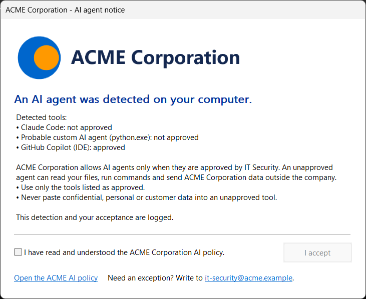

# Agent Detector

Detect AI agents on company Windows PCs, and make every user accept your AI
policy. Detection only: Agent Detector never blocks, closes or uninstalls
anything.



*The window users see, here with the ACME demo branding from
[examples/branding-demo](examples/branding-demo): a fictitious company, for
previews only.*

This README is a deployment tutorial for Microsoft 365 administrators. Follow
the five sections in order, from this folder to every PC enrolled in Intune.

| Section | What you do | Result |
|---|---|---|
| [1. What is Agent Detector](#1-what-is-agent-detector) | Learn what it detects and what users see | You know what to expect |
| [2. Customize the detector](#2-customize-the-detector-logo-disclaimer-urls) | Add your logo, texts, policy link and e-mail | Your branding is ready |
| [3. Recompile the binary](#3-recompile-the-binary) | Build with one command, preview the window | The package in `dist` |
| [4. Sign the binary](#4-sign-the-binary) | Sign with your code-signing certificate | Signed files |
| [5. Push it with Intune](#5-push-the-binary-to-all-your-company-laptops-with-intune) | Package, add the Win32 app, assign it to all devices | Agent Detector on every PC |

Technical details, such as the detection logic, events and troubleshooting, are
in [docs/REFERENCE.md](docs/REFERENCE.md).

## 1. What is Agent Detector

Agent Detector is a small Windows program, `detectoragent.exe`. Intune installs
it on each PC with a scheduled task that scans the PC two minutes after each
logon, then every hour. A scan takes well under two seconds and makes no network
connection.

### What it finds

- **Known AI tools.** About 40 of them, such as Claude Code, OpenAI Codex,
  GitHub Copilot, Cursor, Windsurf, Gemini CLI, Ollama and LM Studio.
- **Home-made agents.** Any script or program connected to an AI service, such
  as OpenAI, Anthropic, Mistral or an aggregator like OpenRouter, and above all
  one that also runs commands on the PC.
- **Recent use.** Windows keeps traces of the programs that ran, so a tool used
  between two scans is found too.

### What users see

When an AI tool is found, the window shown at the top of this page opens on the
user's screen. The user must tick the box, then click **I accept**; the window
has no close button. It comes back at every scan as long as an AI tool is
detected: installed, running, or used in the last 30 days. Approved tools
never open the window on their own; when it opens for an unapproved tool,
they are listed too, marked "approved". Leftover files of an uninstalled tool never open
the window.

### What IT Security gets

Every scan writes to the Windows Event Log (Application log, source
`DetectorAgent`). Collect these events in your SIEM, for example Microsoft
Sentinel, to see who uses which tool and who accepted the policy.

| Event ID | Meaning |
|---|---|
| 100 | Scan summary |
| 300 | AI tool found, with the user and the evidence |
| 400 | Window shown to a user |
| 410 | User accepted; the event carries the user's identity |
| 900 | Error |

Agent Detector never collects prompts, conversations, file contents or API keys.

### Before you start

- [ ] A Windows 10 or 11 workstation with internet access, and a copy of this
  folder.
- [ ] The Intune Administrator or Application Manager role in your Microsoft 365
  tenant.
- [ ] PCs running Windows 10 22H2 or Windows 11, in the Pro, Business,
  Enterprise or Education edition (not Home), joined to Microsoft Entra ID or
  hybrid joined, and enrolled in Intune.
- [ ] A code-signing certificate. It is recommended, and mandatory if your PCs
  enforce the AllSigned PowerShell policy (section 4).

## 2. Customize the detector (logo, disclaimer, URLs)

Everything users see comes from the [branding](branding) folder. You edit it
once; the build in section 3 puts it in the package.

1. Copy your logo into `branding`: a PNG (transparency supported) or a JPEG. It
   is scaled down to fit 540 × 80 pixels and never enlarged, so a wide logo of
   about that size looks best.
2. If your AI policy is a document rather than a web page, copy it into
   `branding` too: PDF, Word, HTML or text.
3. Open `branding\branding.yaml` in Notepad or VS Code and fill in your values.
   Every field is explained in the file. A field left empty keeps the default
   text.

   ```yaml
   version: 1                     # increase it whenever you change the text
   company: "Contoso"
   logo: contoso-logo.png         # a file in the branding folder
   policy: "https://contoso.sharepoint.com/sites/security/ai-policy"   # or a file, such as AI-Policy.pdf
   email: "it-security@contoso.com"
   ```

4. Optional: change the texts of the window in the same file.

   | Field | Text |
   |---|---|
   | `title` | Title bar |
   | `heading` | Large blue sentence under the logo |
   | `text` | Main text, shown after the list of detected tools |
   | `checkbox` | Box the user must tick |
   | `button` | The only button, "I accept" by default |
   | `policy_label` | Link to the AI policy |
   | `email_subject` | Subject of the e-mail that the contact link opens |
   | `contact_text` | Sentence with the contact link; it must contain `{email}` |

   In every text, `{company}` and `{email}` are replaced by your values. For
   `logo`, `policy` and `email`, the value `none` removes the element.

5. Optional: declare the tools your company approves. Add their ids under
   `sanctioned` in [rules/catalog.yaml](rules/catalog.yaml); the ids are listed
   in [the reference](docs/REFERENCE.md#tool-ids). The list also accepts AI
   service addresses, such as your company's Azure OpenAI endpoint.

   ```yaml
   sanctioned: [github-copilot, contoso.openai.azure.com]
   ```

   Approved tools no longer open the window on their own (they are listed,
   marked "approved", when it opens for another tool) and no longer count as
   violations: no warning in the Event Log, and no issue in the Intune
   report.

> **Important:** have the final text validated by your legal team and your data
> protection officer before you deploy. In France, also update the IT charter
> and inform the CSE.

## 3. Recompile the binary

1. Install Go 1.26 or later, once: run `winget install GoLang.Go`, or use the
   installer from [go.dev/dl](https://go.dev/dl/). Then open a new PowerShell
   window.
2. In PowerShell, go to this folder and build. Go downloads the components it
   needs, so keep internet access.

   ```powershell
   Set-ExecutionPolicy -Scope Process -ExecutionPolicy Bypass   # lets this window run build.ps1
   .\build.ps1 -Version 1.0.0
   ```

   The build runs the tests, builds the program, and ends with the values
   Intune uses to detect the installation:

   ```text
   Built dist\detectoragent.exe 1.0.0 (file version 1.0.0.0, branding version 1)
   Intune detection rule: HKEY_LOCAL_MACHINE\SOFTWARE\DetectorAgent, value Package, Equals:
     production app (disclaimer):  1.0.0.0-b1-disclaimer
     pilot app (-NoDisclaimer):    1.0.0.0-b1-silent
   ```

3. Preview the window with your branding:

   ```powershell
   .\dist\detectoragent.exe disclaimer --preview --branding .\branding\branding.yaml
   ```

   The preview reads your files directly: change them, close the window, run
   the command again. If the file has a mistake, such as an unknown field, an
   invalid address or a missing logo, the command lists every problem instead.
   Preview `.\examples\branding-demo\branding.yaml` to get the window shown at
   the top of this page.

4. Optional: see what the detector finds on your own PC. In an administrator
   PowerShell window, this lists the findings without opening the window or
   writing to the Event Log:

   ```powershell
   .\dist\detectoragent.exe scan --format text --no-disclaimer --no-eventlog
   ```

The `dist` folder now holds everything Intune will deploy:

| File | Role |
|---|---|
| `detectoragent.exe` | The detector |
| `install.ps1`, `uninstall.ps1` | Install and uninstall scripts, run by Intune |
| `intune-detect.ps1` | Optional Intune report (section 5, Step 4) |
| `branding\` | Copy of your branding folder |

> **Note:** the build empties `dist` every time, so always edit `branding`,
> never `dist\branding`. Give every release a new version number, such as
> 1.0.1, then 1.0.2: Intune uses it to find the PCs that need the update.

## 4. Sign the binary

Signing proves that the files come from your company, and antivirus software
trusts signed files more. You need a code-signing certificate, with its private
key, in your certificate store. It can come from your company PKI (Active
Directory Certificate Services, "Code Signing" template) or from a public
certificate authority. No other tool is needed.

1. Find the certificate's thumbprint:

   ```powershell
   Get-ChildItem Cert:\CurrentUser\My, Cert:\LocalMachine\My -CodeSigningCert |
       Format-List Subject, NotAfter, Thumbprint
   ```

2. Build and sign:

   ```powershell
   .\build.ps1 -Version 1.0.0 -CertThumbprint 0123456789ABCDEF0123456789ABCDEF01234567
   ```

   The build signs `detectoragent.exe` and the three scripts, with a timestamp
   that keeps the signatures valid after the certificate expires. It stops if a
   signature is not valid, for example when your workstation does not trust the
   certificate.

3. Check that every line says `Valid`:

   ```powershell
   Get-AuthenticodeSignature .\dist\*.exe, .\dist\*.ps1 | Format-Table Status, Path
   ```

### If your PCs enforce AllSigned

Run `Get-ExecutionPolicy -List` on a PC. If AllSigned appears under
MachinePolicy or UserPolicy, only signed scripts run there, even though the
Intune command says `-ExecutionPolicy Bypass`. The PCs must also trust your
certificate as a publisher: otherwise PowerShell asks for a confirmation that
nobody can give during a silent install, and the install fails. Deploy the
certificate to their Trusted Publishers store before the app:

1. Get the certificate in Base64, on one line. Use `Cert:\LocalMachine\My` if
   your certificate is there.

   ```powershell
   [Convert]::ToBase64String((Get-Item Cert:\CurrentUser\My\<thumbprint>).RawData)
   ```

2. In Intune, go to **Devices > Manage devices > Configuration > Create > New
   policy**. Choose **Windows 10 and later**, then **Templates**, then
   **Custom**.
3. Add one OMA-URI setting:

   | Field | Value |
   |---|---|
   | OMA-URI | `./Device/Vendor/MSFT/RootCATrustedCertificates/TrustedPublisher/<thumbprint>/EncodedCertificate` |
   | Data type | **String** |
   | Value | The Base64 line from step 1 |

4. Assign the profile to the same PCs as the app.

With Group Policy instead, use Computer Configuration > Policies > Windows
Settings > Security Settings > Public Key Policies > Trusted Publishers. A
certificate from your company PKI also needs its root certificate trusted on
the PCs, which is usually already the case.

## 5. Push the binary to all your company laptops with Intune

Intune deploys a program like this one as a **Win32 app**. You wrap the files in
an `.intunewin` package, add it in the Intune admin center, then assign it to
all your PCs.

### Step 1: Prepare and package the files

1. Create two folders on your workstation, `C:\IntuneSource\Input` and
   `C:\IntuneSource\Output`.
2. Copy the content of `dist` into the Input folder. Put nothing else there:
   every file in it goes into the package.

   ```powershell
   New-Item -ItemType Directory -Force C:\IntuneSource\Input, C:\IntuneSource\Output | Out-Null
   Copy-Item .\dist\* C:\IntuneSource\Input -Recurse -Force
   ```

3. Download `IntuneWinAppUtil.exe`, the Microsoft Win32 Content Prep Tool, from
   [its GitHub repository](https://github.com/microsoft/Microsoft-Win32-Content-Prep-Tool),
   for example to `C:\Tools`. Keep it out of the Input folder.
4. Run `C:\Tools\IntuneWinAppUtil.exe` and answer its questions:

   | Question | Answer |
   |---|---|
   | Source folder | `C:\IntuneSource\Input` |
   | Setup file | `install.ps1` |
   | Output folder | `C:\IntuneSource\Output` |
   | Catalog folder (Y/N) | `N` |

   You get `C:\IntuneSource\Output\install.intunewin`.

> **Shortcut:** `build.ps1` can do these four steps for you. This command
> builds, signs and packages, and writes `out\detectorAgent-1.0.0.intunewin`:
>
> ```powershell
> .\build.ps1 -Version 1.0.0 -CertThumbprint <thumbprint> -IntuneWinAppUtil C:\Tools\IntuneWinAppUtil.exe
> ```

### Step 2: Add the app in the Intune admin center

1. Sign in to the [Microsoft Intune admin center](https://intune.microsoft.com).
2. Go to **Apps > All Apps > Create**.
3. In **Select app type**, choose the **Windows** platform, then
   **Windows app (Win32)**, then click **Select**.
4. **App package file.** Click **Select app package file**, browse to your
   `.intunewin` file, then click **OK**.
5. **App information.** Fill in the required fields, then click **Next**.

   | Field | Value |
   |---|---|
   | Name | `Agent Detector` |
   | Description | `Detects AI agents and shows the company AI policy. Detection only.` |
   | Publisher | Your IT Security team |

6. **Program.** Fill in the fields, then click **Next**.

   | Field | Value |
   |---|---|
   | Installer type | **Command line** |
   | Install command | `powershell.exe -NoProfile -ExecutionPolicy Bypass -File .\install.ps1` |
   | Uninstall command | `powershell.exe -NoProfile -ExecutionPolicy Bypass -File .\uninstall.ps1` |
   | Installation time required | `15` minutes |
   | Allow available uninstall | **No** |
   | Install behavior | **System** |
   | Device restart behavior | **No specific action** |
   | Return codes | Keep the defaults |

   Both commands are silent. Intune starts `powershell.exe` as a 32-bit
   process; `install.ps1` detects it and restarts itself in 64-bit PowerShell,
   so you need no `sysnative` path.

7. **Requirements.** Set the operating system architecture to the 64-bit
   systems, **x64** and **ARM64**. Set the minimum operating system to
   **Windows 10 22H2**, or the closest version in the list. Click **Next**.
8. **Detection rules.** Set the rules format to **Manually configure detection
   rules**, click **Add**, fill in the rule, click **OK**, then **Next**.

   | Field | Value |
   |---|---|
   | Rule type | **Registry** |
   | Key path | `HKEY_LOCAL_MACHINE\SOFTWARE\DetectorAgent` |
   | Value name | `Package` |
   | Detection method | **String comparison** |
   | Operator | **Equals** |
   | Value | `1.0.0.0-b1-disclaimer`: the production value printed by the build |
   | Associated with a 32-bit app on 64-bit clients | **No** |

   `install.ps1` writes this value last, so Intune sees the app as installed
   only when every step succeeded.

9. **Dependencies** and **Supersedence**: add nothing, click **Next**. On
   **Assignments**, under **Required**, click **Add all devices** to target every
   PC enrolled in Intune. In its row, click **Show all toast notifications** and
   choose **Hide all toast notifications**. Click **Next**.
10. **Review + create.** Click **Create**, and wait until the upload finishes.

**Options.** Decide these before the first deployment:

- **Test on a few PCs first.** On **Assignments**, click **Add group** instead of
  **Add all devices**, and pick a group of test PCs. Add all devices once Step 3
  passes.
- **Corporate PCs only.** If personal PCs are enrolled in your tenant, create an
  assignment filter in **Tenant administration > Assignment filters > Create >
  Managed devices**, for **Windows 10 and later**, with this rule. Then, in the
  assignment row, choose **Include filtered devices in assignment** and that
  filter.

  ```text
  (device.deviceOwnership -eq "Corporate")
  ```
- **Scan less often.** The task scans every hour. Add, for example,
  `-IntervalMinutes 240` at the end of the install command; the value goes from
  15 to 1440 minutes.
- **Start silently.** To see what the detector finds before users see any
  window, add `-NoDisclaimer` at the end of the install command, and use the
  pilot value printed by the build, such as `1.0.0.0-b1-silent`, in the
  detection rule. PCs then scan and log only. To show the window later, open the
  app's **Properties**: under **Program**, remove `-NoDisclaimer`; under
  **Detection rules**, set the production value. PCs switch over at their next
  check-in.

### Step 3: Check the deployment

The Intune agent on each PC checks for new apps every hour and at each restart.
PCs that are off install the app when they come back online.

1. In Intune, open **Apps > All Apps > Agent Detector**. **Device install
   status** shows each PC as Installed, Failed or Pending.
2. On a PC, check the install in an administrator PowerShell window:

   ```powershell
   # Install marker: Package must equal the detection value
   Get-ItemProperty HKLM:\SOFTWARE\DetectorAgent | Select-Object Package, Mode, InstalledAt

   # Scan task: LastTaskResult 0 (nothing found) or 1 (unapproved tool found) is normal; 2 is an error
   Get-ScheduledTask -TaskPath \DetectorAgent\ | Get-ScheduledTaskInfo |
       Select-Object LastRunTime, LastTaskResult, NextRunTime

   # Latest events
   Get-WinEvent -LogName Application -FilterXPath "*[System[Provider[@Name='DetectorAgent']]]" -MaxEvents 10 |
       Select-Object TimeCreated, Id, LevelDisplayName
   ```

3. See the window. Sign in to a PC as a user who has an AI tool installed, such
   as GitHub Copilot in VS Code. Start a scan from an administrator PowerShell
   window; the window opens on the user's screen within seconds.

   ```powershell
   Start-ScheduledTask -TaskPath \DetectorAgent\ -TaskName 'DetectorAgent Scan'
   ```

4. If an install fails, read `DetectorAgent-install.log`, then
   `AppWorkload.log`, both in
   `C:\ProgramData\Microsoft\IntuneManagementExtension\Logs`. Common causes and
   fixes are in [the reference](docs/REFERENCE.md#troubleshooting).

> **Tip:** in your SIEM, every PC sends a scan summary (event 100) at every
> scan, hourly by default. Alert when a PC sends none for more than 24 hours:
> someone may have removed the task.

### Step 4: See unapproved tools in Intune (optional)

A Remediations script shows, for each PC, the unapproved AI tools found. It
requires Windows Enterprise E3/E5, Education A3/A5 or Windows VDA licenses.

1. Go to **Devices > Manage devices > Scripts and remediations > Create script
   package**, and name it `Agent Detector - unapproved AI tools`.
2. Set the detection script file to `dist\intune-detect.ps1`, with no
   remediation script, and these settings:

   | Setting | Value |
   |---|---|
   | Run this script using the logged-on credentials | **No** |
   | Enforce script signature check | **No**, unless you signed the scripts |
   | Run script in 64-bit PowerShell | **No** |

3. Assign it to the same PCs as the app, on a daily schedule.

PCs with unapproved tools show **With issues**, and the
**Pre-remediation detection output** column names the tools.

### Step 5: Update or uninstall

To ship a change, such as a new text, logo, approved tool or program version:

1. Make the change in `branding` or `rules\catalog.yaml`. If you changed the
   text, increase `version` in `branding.yaml`: events 400 and 410 record it,
   which proves which text each user accepted.
2. Rebuild with a new version number, such as `-Version 1.0.1`, and package
   again as in Step 1. Empty the Input folder before you copy the new files.
3. In Intune, open **Apps > All Apps > Agent Detector > Properties**. Under
   **App information**, select the new `.intunewin` file. Under **Detection
   rules**, set the new value printed by the build. Save.

PCs update at their next check-in, every hour or at restart.

To uninstall Agent Detector, edit the app's assignments: remove **All devices**
from **Required**, and add it under **Uninstall**. Intune then removes the
scheduled task, the files and the install marker. Events already written stay
in the Event Log.
